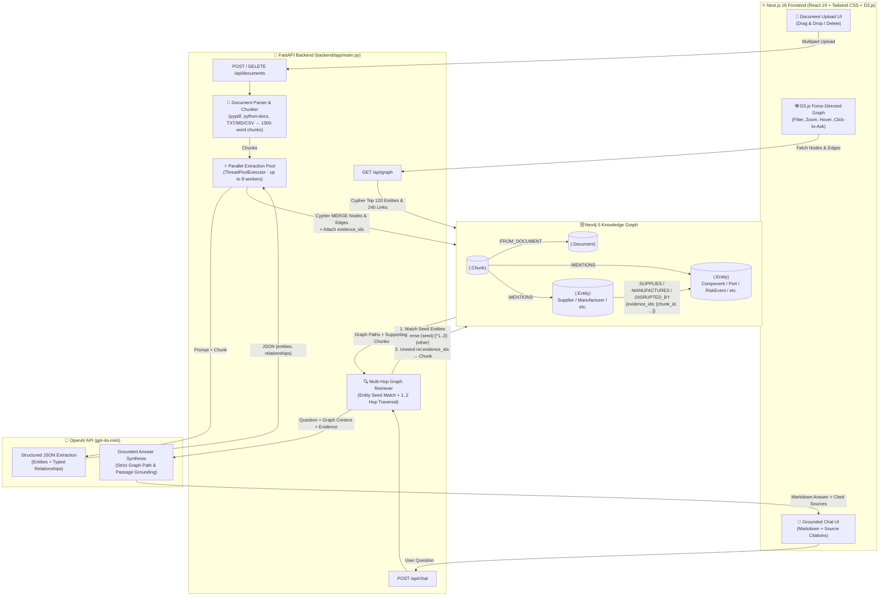

# 🔗 Supply Chain Risk Explorer — Graph RAG

A graph-based knowledge extraction and question-answering application for supply chain research. Upload supplier documents, extract entities and relationships into a Neo4j knowledge graph, and ask multi-hop questions with cited source evidence.

---

## 🌍 Overview

This app is scoped to supply-chain research. Upload supplier reports, procurement documents, logistics reports, and relevant public company disclosures. It extracts suppliers, manufacturers, components, products, facilities, regions, ports, risk events, and related supply-chain facts using a bounded set of relationship types.

Questions can follow connections up to two graph steps — for example, _"Which manufacturers connect to this supplier, and what evidence supports that link?"_ — and cite passages recorded as evidence for each relationship. Use public or clearly labeled sample data for demonstration; extracted relationships are research leads that need validation.

---

## 🛠️ Tech Stack

| Layer | Technology |
|---|---|
| **Frontend** | [Next.js 16](https://nextjs.org/) (App Router) · [React 19](https://react.dev/) · [TypeScript](https://www.typescriptlang.org/) · [Tailwind CSS](https://tailwindcss.com/) |
| **Graph Visualization** | [D3.js v7](https://d3js.org/) (Force-directed interactive graph, zoom/pan, entity filtering) |
| **UI Components & Markdown** | [Lucide Icons](https://lucide.dev/) · [react-markdown](https://github.com/remarkjs/react-markdown) |
| **Backend** | [FastAPI](https://fastapi.tiangolo.com/) + [Uvicorn](https://www.uvicorn.org/) (Python 3.12) |
| **Graph Database** | [Neo4j 5 Community](https://neo4j.com/) (Cypher, Bolt protocol) |
| **AI / LLM** | [OpenAI API](https://platform.openai.com/) — `gpt-4o-mini` (structured JSON entity extraction + grounded Q&A) |
| **Document Parsing** | [pypdf](https://pypdf.readthedocs.io/) · [python-docx](https://python-docx.readthedocs.io/) · TXT / CSV / Markdown |
| **Containerization** | [Docker](https://www.docker.com/) (Multi-stage build) + [Docker Compose](https://docs.docker.com/compose/) |

---

## 📂 Project Structure

```text
supply-chain-risk-explorer/
├── backend/                     # 🐍 FastAPI Backend (Python)
│   ├── app/
│   │   ├── __init__.py
│   │   └── main.py              # REST API routes, Neo4j Cypher queries & OpenAI Graph-RAG logic
│   └── requirements.txt         # Python backend dependencies
│
├── frontend/                    # ⚛️ Next.js 16 Frontend (TypeScript + Tailwind CSS)
│   ├── src/
│   │   └── app/
│   │       ├── globals.css      # Global Tailwind & Markdown prose styles
│   │       ├── layout.tsx       # Root Next.js App Router layout & metadata
│   │       └── page.tsx         # Supply Chain Explorer UI, D3 force graph & chat interface
│   ├── next.config.mjs          # Next.js configuration
│   ├── package.json             # Frontend dependencies & scripts
│   ├── postcss.config.mjs       # PostCSS configuration
│   ├── tailwind.config.ts       # Tailwind CSS configuration
│   └── tsconfig.json            # TypeScript configuration
│
├── uploads/                     # 📁 Uploaded source documents (git-ignored)
├── .env.example                 # 🔑 Environment variable template
├── .gitignore                   # Git ignore rules
├── Dockerfile                   # 🐳 Multi-stage Docker build (Next.js + FastAPI)
├── docker-compose.yml           # 🧩 Docker Compose orchestration (Neo4j + App)
└── README.md                    # 📖 Project documentation
```

---

## 🏗️ System Architecture (Graph RAG)



---

## ⚙️ Architecture & Features

- **Automated Graph Extraction:** Splits uploaded documents into chunks and extracts structured supply-chain entities and relationships into Neo4j, linking every relationship edge to the exact source chunk IDs that support it.
- **Interactive Force-Directed Graph:** Built with D3.js in Next.js — color-coded by entity type, sized by mention frequency, with live search filtering, zoom/pan controls, hover relationship inspection, and click-to-query.
- **Multi-Hop Grounded Chat:** Traverses 1 to 2 hops across the Neo4j knowledge graph, synthesizes answers strictly from retrieved paths, renders rich Markdown responses, and displays supporting document excerpts.
- **Full Document Lifecycle:** Upload PDF, DOCX, TXT, MD, or CSV files and delete documents cleanly (automatically pruning orphaned entities and relationship evidence from Neo4j).

**Entity types extracted:** `Supplier`, `Manufacturer`, `Company`, `Component`, `Product`, `Facility`, `Region`, `Country`, `Port`, `RiskEvent`, `Regulation`, `Person`

**Relationship types:** `SUPPLIES`, `MANUFACTURES`, `SOURCES_FROM`, `PART_OF`, `LOCATED_IN`, `SHIPS_THROUGH`, `AFFECTED_BY`, `DISRUPTED_BY`, `OPERATES_IN`, `OWNED_BY`, `MITIGATES`, `RELATED_TO`

---

## 🚀 Run Locally

### Prerequisites
- [Docker](https://www.docker.com/get-started) & Docker Compose installed
- An [OpenAI API key](https://platform.openai.com/api-keys)

### Steps

```bash
# 1. Clone the repository
git clone https://github.com/shivang17d/Supply-Chain-Risk-Explorer.git
cd Supply-Chain-Risk-Explorer

# 2. Set up environment variables
cp .env.example .env
# Edit .env and add your OPENAI_API_KEY

# 3. Build and start the stack
docker compose up --build
```

- 🌐 **Web App (Next.js UI + FastAPI):** http://localhost:8001
- 📖 **Interactive API Docs (Swagger):** http://localhost:8001/docs
- 🗄️ **Neo4j Browser:** http://localhost:7474 (credentials: `neo4j` / `graph-rag-local`)

**Accepted formats:** PDF, DOCX, TXT, Markdown, CSV — default upload limit is **20 MB**.

---

## 📡 API Reference

| Method | Endpoint | Description |
|---|---|---|
| `GET` | `/api/health` | Health check & Neo4j connectivity status |
| `GET` | `/api/documents` | List all indexed documents |
| `POST` | `/api/documents` | Upload and index a document (`multipart/form-data`, field: `file`) |
| `DELETE` | `/api/documents/{id}` | Delete a document and prune orphaned graph data |
| `GET` | `/api/graph` | Retrieve graph nodes and edges |
| `POST` | `/api/chat` | Ask a supply-chain question (`{ "question": "..." }`) |

---

## 🏗️ Design Notes

- The extraction prompt constrains entity and relationship categories strictly to the supply-chain domain.
- Typed graph edges store the IDs of the source chunks that support them.
- Retrieval matches entities in the question, traverses paths up to **two edges**, and returns supporting passages as citations.
- Entity matching is currently **lexical** — model-extracted facts still require human validation.
- For production use, add: authentication, rate limiting/quotas, file malware scanning, background task queues, observability, backups, and secret management.

---

## 📄 License

MIT
